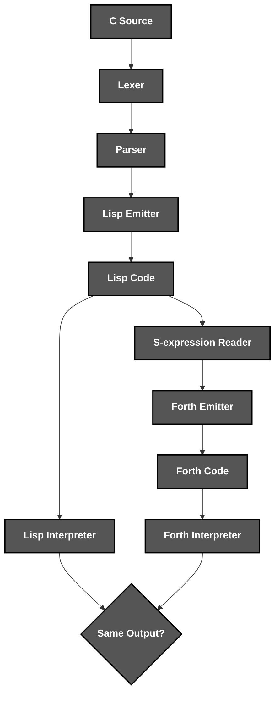
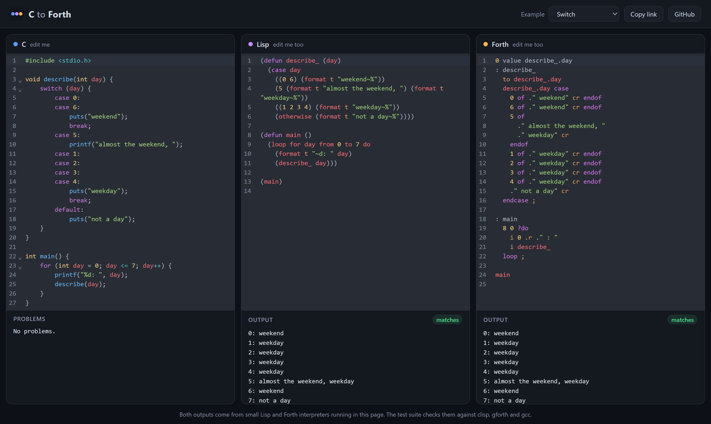

<div align="center">


*A **C** to **Lisp** to **Forth** compiler that runs in your **browser***

**[▶️ Try it live](https://cristiangilsanz.github.io/c-to-forth/)**

</div>

# 📝 **Description**

<div align="center">

***C to Forth*** is a **two-stage compiler** that turns C into ***Lisp*** and then ***Forth***, running both in the browser and checking them against ***clisp***, ***gforth*** and ***gcc***
</div>
<br>
<div align="right">

***It was born as a third-year university project*** 🎓

</div>

# 🛠️ **Compiler Architecture & Workflow**

<div align="center">


</div>

# 📁 **Project Structure**

```
c-to-forth/
├── .gitattributes                                      # Git Attributes Configuration
├── .gitignore                                          # Git Ignore Rules
├── biome.json                                          # Lint & Format Configuration
├── index.html                                          # Playground Page
├── LICENSE                                             # Project License
├── package.json                                        # Scripts & Dependencies
├── README.md                                           # You are here! ⬅️
├── tsconfig.json                                       # TypeScript Configuration
├── vite.config.ts                                      # Build & Test Configuration
│
├── .github/workflows/
│   ├── ci.yml                                          # Lint & Test Pipeline
│   └── pages.yml                                       # GitHub Pages Deployment
│
├── assets/                                             # Visual Assets
│   ├── logo.svg                                        # Project Logo
│   └── playground.png                                  # Playground Screenshot
│
├── examples/                                           # Example C Programs
│
├── public/
│   └── favicon.svg                                     # Playground Icon
│
├── src/
│   ├── compiler/
│   │   ├── lexer.ts                                    # C Tokens
│   │   ├── parser.ts                                   # C Syntax Tree
│   │   ├── lisp.ts                                     # C to Lisp Translation
│   │   ├── sexpr.ts                                    # S-expression Reader & Printer
│   │   ├── forth.ts                                    # Lisp to Forth Translation
│   │   └── reserved.ts                                 # Common Lisp & Gforth Names
│   │
│   ├── runtime/
│   │   ├── lisp.ts                                     # Lisp Interpreter
│   │   └── forth.ts                                    # Forth Interpreter
│   │
│   └── web/                                            # Playground Editor & Styles
│
└── tests/
    ├── expected/                                       # Verified Lisp, Forth & Outputs
    ├── fixtures/course/                                # Original Course Test Programs
    ├── fixtures/lisp/                                  # Hand-Written Lisp Programs
    ├── fixtures/forth/                                 # Hand-Written Forth Programs
    └── *.test.ts                                       # Unit, Golden & Toolchain Tests
```

# 🔧 **Installation**

## 📋 Requirements

- **Node.js 20+**

## ⚙️ Quick Setup

1. **Clone the repository**
   ```bash
   git clone https://github.com/cristiangilsanz/c-to-forth.git
   cd c-to-forth
   ```

2. **Install the dependencies**
   ```bash
   npm install
   ```

<br>

# 🚀 **See *C to Forth* in Action**

## 🖥️ To Open the Playground:

1. **Start the development server:**

```bash
npm run dev
```

2. **Pick an example or write your own C, and watch the Lisp, the Forth and both outputs update as you type. The Lisp and Forth panes can be edited too.**

## 🧪 To Run the Tests:

1. **Run the tests and the linter:**

```bash
npm test
npm run lint
```

2. **Install the real toolchains to also check every program against them** *(optional, Linux)*:

```bash
sudo apt-get install clisp gforth gcc
```

## 📦 To Build the Site:

1. **Build the static playground into `dist/`:**

```bash
npm run build
```

# 🖼️ **Playground**

<div align="center">
    
</div>

<br>

## 🔄 Translations

<div align="center">

| C | Lisp | Forth |
|---|---|---|
| `int x = 5;` | `(setq x 5)` | `5 value x` |
| `int v[] = {1, 2, 3};` | `(setq v (vector 1 2 3))` | `create v 1 , 2 , 3 ,` |
| `x += v[i];` | `(incf x (aref v i))` | `x v i cells + @ + to x` |
| `printf("%d\n", x);` | `(format t "~d~%" x)` | `x 0 .r cr` |
| `if (a < b) ... else ...` | `(if (< a b) ... ...)` | `a b < if ... else ... then` |
| `for (int i = 0; i < n; i++)` | `(dotimes (i n) ...)` | `n 0 max 0 ?do ... loop` |
| `while (n > 0) ...` | `(loop while (> n 0) do ...)` | `begin n 0 > while ... repeat` |
| `switch (d) { case 1: ... }` | `(case d (1 ...))` | `d case 1 of ... endof endcase` |
| `int f(int n) { ... }` | `(defun f (n) ...)` | `: f to f.n ... ;` |
| `a / b` and `a % b` | `(truncate a b)` and `(rem a b)` | `a b quot` and `a b rem` |

</div>

## 📄 Supported C

<div align="center">

| Feature | Details |
|:---:|---|
| Types | `int`, `char`, `short`, `long` and `bool` as integers, arrays with initializers |
| Statements | `if`, `else`, `while`, `do while`, `for`, `switch`, `break`, `continue` and `return` |
| Operators | Arithmetic, comparisons, logic, bitwise, shifts, `?:`, assignments, `++`, `--` and casts |
| Functions | Prototypes, recursion, mutual recursion and array parameters |
| Output | `puts`, `putchar` and `printf` with `%d`, `%c`, `%s`, `%%` and field widths |
| Extras | Hex, octal and character literals, `#` lines are skipped and `//@` lines go into the Lisp |

</div>

## 🗣️ Supported Lisp & Forth

<div align="center">

| Stage | Details |
|:---:|---|
| Lisp Interpreter | Numbers, characters, strings, lists, vectors, closures, `loop`, `format` and special variables |
| Lisp to Forth | `defun`, `let`, `cond`, `case`, `dotimes`, `loop` with `sum` and `count`, `block` and vectors |
| Forth Interpreter | Colon definitions, `do` loops, `case`, `defer`, `value`, `create`, strings and number bases |

</div>

# 💡 **Tips for Best Results**

Every program is checked against real compilers, so outputs that differ always point to a bug worth reporting.

**Examples of a great run:**

> - Write a ***recursive*** function and see Forth save its locals.
> - Edit the ***Lisp*** pane and watch the Forth follow.
> - Share your code with ***Copy link***.

# 📚 **Tech Stack & Other Resources**

## 📦 Tech Stack

### 🧩 **Programming Language**
- [TypeScript](https://www.typescriptlang.org/docs/)

### 🖥️ **Playground**
- [Vite](https://vite.dev/guide/)
- [CodeMirror](https://codemirror.net/docs/)

### 🗣️ **Target Languages**
- [Common Lisp](https://www.lispworks.com/documentation/HyperSpec/Front/)
- [Forth](https://forth-standard.org/)

### 🧪 **Testing**
- [Vitest](https://vitest.dev/guide/)
- [GNU CLISP](https://clisp.sourceforge.io/)
- [Gforth](https://gforth.org/)

### 🧹 **Code Quality**
- [Biome](https://biomejs.dev/)

### ⚙️ **Continuous Integration**
- [GitHub Actions](https://docs.github.com/actions)
- [GitHub Pages](https://docs.github.com/pages)

# 🙏 **Credits & Thanks**

This project was created together with ***Paola Herráez Bravo*** in our third year of university 🤝.

Thanks to the *GNU CLISP* and *Gforth* teams for the reference implementations every output is checked against ✨.

# 📄 **License**

This project is licensed under the MIT License - see the [LICENSE](LICENSE) file for details.

# 📞 **Get Help & Connect**

- 🐛 [Open an issue](https://github.com/cristiangilsanz/c-to-forth/issues)
- 📧 cristiangilsanz@gmail.com

<div align="center">
  <br>

  **Made with 💖 for the Compiler Community**

  [⭐ Star this repo](https://github.com/cristiangilsanz/c-to-forth) | [🍴 Fork it](https://github.com/cristiangilsanz/c-to-forth/fork)

  <br>

  <a href="https://www.buymeacoffee.com/cristiangilsanz" target="_blank">
    
  </a>

</div>
